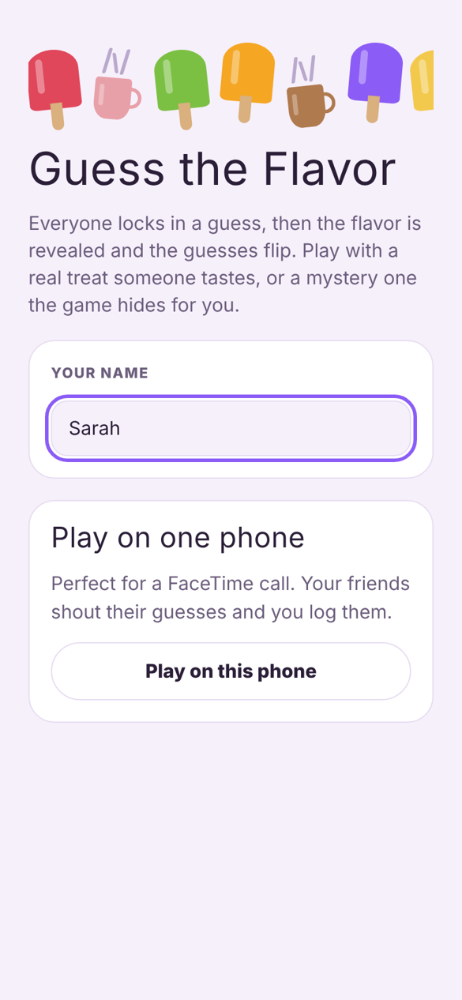
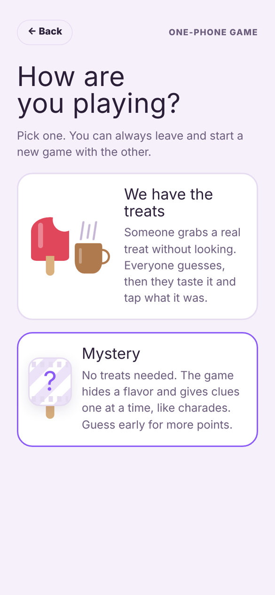
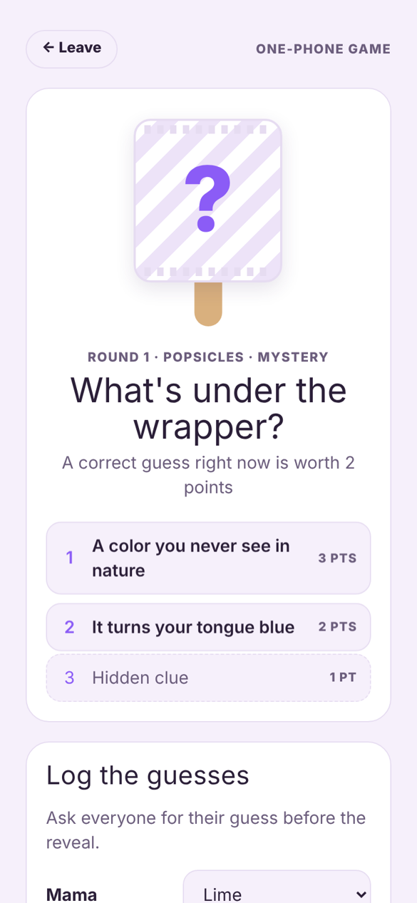
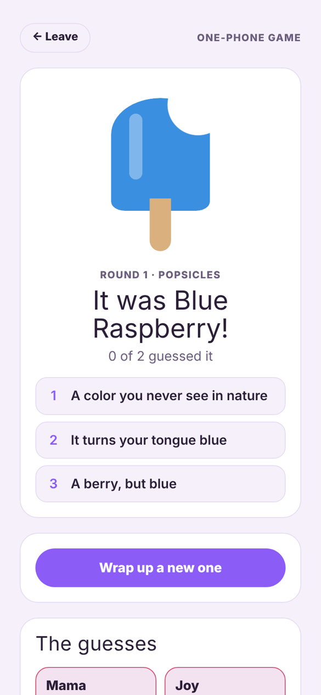

# Guess the Flavor

**A party game where friends guess a flavor before it's revealed.**

It started on a FaceTime call. I was eating popsicles without looking at the flavor, and my friends kept guessing which one I had before I could taste it. They had so much fun they kept waiting for me to grab another one. So I turned it into a game.

[**Play it here**](https://sarah-kayembe.github.io/guess-the-flavor/)

<table>
<tr>
<td width="25%"></td>
<td width="25%"></td>
<td width="25%"></td>
<td width="25%"></td>
</tr>
<tr>
<td align="center">Start a game</td>
<td align="center">Pick how to play</td>
<td align="center">Clues, one at a time</td>
<td align="center">The reveal</td>
</tr>
</table>

## Two ways to play

**We have the treats.** Someone grabs a popsicle, candy or drink without looking. Everyone else locks in a guess. Then they taste it and tap the real flavor, and everyone's guesses flip over at once.

**Mystery.** No treats needed. The game secretly picks a flavor and gives clues one at a time, from vague to obvious, a bit like charades. A right guess after the first clue is worth 3 points, after the second 2, and after the third 1. Guess early and risk it, or wait and play it safe.

## Features

- Flavor sets for popsicles, jelly beans, soda, hot cocoa, tea and fall drinks, or type in your own
- Hand-written clues for every built-in flavor, plus word clues (letter count, first and last letter) for flavors you add
- Popsicle or steaming mug artwork, so it works for cold treats and hot drinks
- Scoreboard and a row of everything revealed so far
- Works in light and dark mode, and on any phone

## How it's built

One self-contained HTML file with plain JavaScript and CSS. No framework, no build step and no server. The popsicles and mugs are drawn in CSS.

To run it locally, just open `index.html` in a browser.

## What's next

An online mode where everyone joins from their own phone with a game code. The game already has the code for it, but it needs a real-time backend such as Supabase Realtime before it can work outside the app I prototyped it in.

---

Built by [Sarah Kayembe](https://github.com/Sarah-Kayembe)
